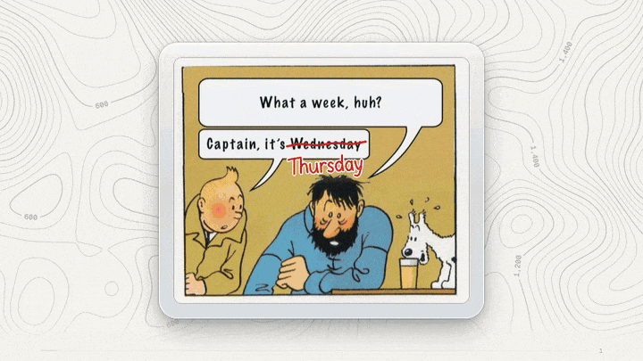
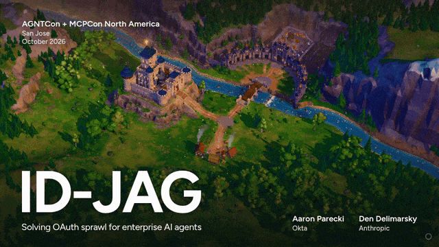

# AGNTCon + MCPCon North America 2026 decks

Slides from two talks at AGNTCon + MCPCon North America in San Jose, October 2026. Each deck is a single HTML file that runs offline, with no build step.

| Talk | Speakers | Slides |
| --- | --- | --- |
| [MCP Security, Two Years In](#mcp-security-two-years-in) | Den Delimarsky | [`mcp-security/index.html`](mcp-security/index.html) |
| [ID-JAG: Solving OAuth sprawl for enterprise AI agents](#id-jag-solving-oauth-sprawl-for-enterprise-ai-agents) | Aaron Parecki (Okta), Den Delimarsky (Anthropic) | [`id-jag/index.html`](id-jag/index.html) |

To view a deck, clone the repository and open its `index.html` in a browser.

## MCP Security, Two Years In

Figures are from public sources as of October 21, 2026.

| Key | Action |
| --- | --- |
| Right, Left | Next or previous slide |
| O | Show every slide |
| F | Full screen |

## ID-JAG: Solving OAuth sprawl for enterprise AI agents

The talk explains the Identity Assertion JWT Authorization Grant and how Enterprise-Managed Authorization for MCP builds on it. The 3D scenes need WebGL, so use a machine with a GPU.

| Key | Action |
| --- | --- |
| Right or Space, Left | Next or previous step (Page Down and Page Up work from a clicker) |
| Down, Up | Next or previous slide |
| A number, then Enter | Jump to that slide |
| F | Full screen |
| S | Speaker notes and timer, over the slide |
| W | Speaker notes and timer, in a second window |
| `]`, `[` | Read on in long notes, go back |
| T | Restart the timer |
| U | Hide "Client holds" and the progress bar |
| Q | Turn post-processing off, for a slow laptop |
| H, Escape | Open help, close it |

Further reading:

- [Enterprise-Managed Authorization](https://modelcontextprotocol.io/extensions/auth/enterprise-managed-authorization) (MCP extension)
- [Identity Assertion JWT Authorization Grant](https://datatracker.ietf.org/doc/draft-ietf-oauth-identity-assertion-authz-grant/) (IETF OAuth draft)

## Licenses

The fonts in the security deck are covered by [`mcp-security/FONT-LICENSE.txt`](mcp-security/FONT-LICENSE.txt).
